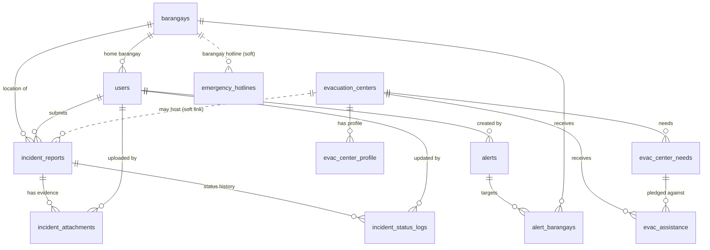

# OBILAK — Database Schema

Engine: **InnoDB** · Charset: **utf8mb4** (collation `utf8mb4_general_ci`)

- **Local (XAMPP):** database name **`capstone`**.
- **Production (Railway):** database name **`railway`**.

There are **16 tables**. The database name is configurable: `config/db_connection.php`
reads `DB_HOST` / `DB_USER` / `DB_PASS` / `DB_NAME` / `DB_PORT` from the environment
(see `.env.example`), defaulting to `capstone`. That is why local and Railway can use
different names for the same schema.

---

## Local vs. Railway

The schema is the **same** on both sides (all 16 tables, identical columns), and the
reference/seed data matches (users, barangays, disaster types, hotlines, evacuation
centers, PCF facilities). The environment-level differences are:

| | Local (`capstone`) | Railway (`railway`) |
|---|---|---|
| Database name | `capstone` | `railway` |
| Connection | `localhost:3306`, user `root`, no password | `mysql.railway.internal:3306`, `root`, password from env |
| Evidence file paths | relative `uploads/...` (local disk) | full Cloudinary URLs (`https://res.cloudinary.com/...`) |
| Dynamic data | only what you create locally | grows continuously (reports, logs, evidence) |

> **Import gotcha.** `database/Railway/capstone.sql` starts with
> `DROP DATABASE IF EXISTS capstone; CREATE DATABASE capstone; USE capstone;`.
> Railway's app connects with **`DB_NAME=railway`** and there is **no `capstone`
> database** on Railway — the tables actually live inside `railway`. Importing that
> file literally would create an unused `capstone` schema and the app would not see it.
> To restore Railway, import into the **`railway`** database (drop/ignore the first
> three lines, or `USE railway`), or create `capstone` and set `DB_NAME=capstone`.

> **Data loss warning.** The dump files `DELETE FROM` each table and the Railway file
> also `DROP DATABASE`s. Re-importing **overwrites** current data. Take a fresh backup
> first (`mysqldump`, or HeidiSQL/phpMyAdmin export).

---

## Importing

| File | Made with | Use |
|------|-----------|-----|
| `database/capstone.sql` | phpMyAdmin (local) | Full structure **and** data for local XAMPP. |
| `database/Railway/capstone.sql` | HeidiSQL | Full structure + data prepared for hosting transfer. |

Both contain the same 16 tables and seed rows.

---

## Entity-Relationship Diagram

> Solid lines are real foreign keys. Dotted lines are **soft links** (an id/name is
> stored but there is no enforced FK). Text-keyed links such as
> `incident_reports.disaster_type` and `evacuation_centers.barangay` are matched by
> name/value.

---

## Tables

### `users`
All system accounts (superadmins, municipal/provincial staff, barangay accounts).

| Column | Type | Notes |
|--------|------|-------|
| `id` | int, PK, auto | |
| `name` | varchar(100) | Display name |
| `username` | varchar(50), **unique** | Login name; `^[A-Za-z0-9._-]{3,50}$` |
| `password` | varchar(255) | **bcrypt hash** |
| `role` | enum | `superadmin`, `barangay`, `pcf`, `pho` |
| `sub_role` | enum | `captain`, `secretary`, `tanod`, `mdr_admin`, `mdr_kalibo`, `mdr_ibajay`, `pdrrmo`, `governor`, `mayor_kalibo`, `mayor_ibajay` (nullable) |
| `can_manage_users` | tinyint(1) | Default `0`; may this account manage other users |
| `barangay_id` | int, FK → `barangays.id` | Set only for barangay accounts |
| `status` | enum | `Active`, `Inactive` |
| `created_at` | timestamp | Defaults to now |

### `barangays`
The barangays used by the system, with map coordinates. **51 rows**:
16 in Kalibo + 35 in Ibajay.

| Column | Type | Notes |
|--------|------|-------|
| `id` | int, PK, auto | |
| `name` | varchar(100) | |
| `municipality` | varchar(100) | Default `Kalibo` |
| `province` | varchar(100) | Default `Aklan` |
| `status` | enum | `Active`, `Inactive` |
| `latitude` | decimal(12,9) | Used by maps & the weather card |
| `longitude` | decimal(12,9) | |
| `population` | int | Default `0`; editable from the dashboard |

### `disaster_types`
Lookup list of disaster categories (10 rows).

| Column | Type | Notes |
|--------|------|-------|
| `id` | int, PK, auto | |
| `name` | varchar(100) | e.g. Typhoon, Flood, Fire, Others |
| `status` | enum | `Active`, `Inactive` |
| `is_natural` | tinyint(1) | `1` for natural hazards, `0` for others |

### `incident_reports`
The heart of the system — one row per reported incident.

| Column | Type | Notes |
|--------|------|-------|
| `id` | int, PK, auto | |
| `user_id` | int, FK → `users.id` | Who submitted it |
| `barangay_id` | int, FK → `barangays.id` | Where it happened |
| `disaster_type` | varchar(100) | Matches a `disaster_types.name` |
| `incident_datetime` | datetime | When the incident occurred |
| `exact_location` | varchar(255) | Free-text location |
| `road_status` | enum | `Passable` (default), `Partially Passable`, `Obstructed` |
| `road_blockage_causes` | varchar(255) | Only stored when status ≠ `Passable` |
| `road_location` | varchar(255) | Where the blockage is |
| `evacuation_needed` | enum | `Yes`, `No` |
| `evacuation_center_id` | int | Soft link → `evacuation_centers.id` |
| `evac_households` | int | Default `0` — evacuated households |
| `evac_adults` | int | Default `0` |
| `evac_children` | int | Default `0` |
| `evac_members` | int | Default `0` — total evacuated |
| `description` | text | |
| `assistance_needed` | text | Free-text needs |
| `latitude` | decimal(10,7) | Map pin |
| `longitude` | decimal(10,7) | |
| `affected_people` | int | Human-impact tally |
| `injured` | int | |
| `dead` | int | |
| `missing` | int | |
| `status` | varchar(50) | Default `Pending` (see status flow below) |
| `referred_to_pho` | tinyint(1) | `0`/`1` flag |
| `is_demo` | tinyint(1) | `1` marks seeded demo rows |
| `created_at` | timestamp | |
| `client_uuid` | varchar(36), **unique** | Offline-submit idempotency key |
| `pin_outside_area` | tinyint(4) | `1` when the pin falls outside the barangay |

**Status flow (10):** `Pending` → `Reviewed` → `Forwarded to PCF` →
`Under MDR Review` → `Verified` → `Responding` → `Referred to PHO` →
`Under PHO Review` → `Resolved`, or `Dismissed` at any review point. A report can be
**edited by the barangay while it is still `Pending`**. `Forwarded to PHO` is a legacy
alias that is normalised to `Referred to PHO`.

### `incident_attachments`
Photo/video evidence attached to a report.

| Column | Type | Notes |
|--------|------|-------|
| `id` | int, PK, auto | |
| `incident_report_id` | int, FK → `incident_reports.id` | **ON DELETE CASCADE / ON UPDATE CASCADE** |
| `uploaded_by` | int, FK → `users.id` | |
| `file_name` | varchar(255) | Original file name |
| `file_path` | varchar(255) | Cloudinary URL (prod) or `uploads/...` (local) |
| `file_type` | varchar(50) | `photo` or `video` |
| `file_size` | int | Bytes |
| `created_at` | timestamp | |

> Local rows store a relative path (e.g. `uploads/incidents/report_122/...jpg`);
> production rows store a full `https://res.cloudinary.com/...` URL. Readers accept
> both.

### `incident_status_logs`
The timeline of every status change on a report.

| Column | Type | Notes |
|--------|------|-------|
| `id` | int, PK, auto | |
| `incident_report_id` | int, FK → `incident_reports.id` | **ON DELETE CASCADE / ON UPDATE CASCADE** |
| `old_status` | varchar(100) | Null for the first entry |
| `new_status` | varchar(100) | |
| `remarks` | text | Optional note |
| `updated_by` | int, FK → `users.id` | |
| `created_at` | timestamp | |

### `evacuation_centers`
Directory of evacuation centers.

| Column | Type | Notes |
|--------|------|-------|
| `id` | int, PK, auto | |
| `barangay` | varchar(100) | Barangay **name** (text, soft link) |
| `municipality` | varchar(50) | Default `''` |
| `center_name` | varchar(150) | |
| `center_type` | varchar(100) | e.g. School, Covered Court, Barangay Facility |
| `capacity` | int | Default 0 |
| `current_evacuees` | int | Default 0 |
| `status` | enum | `Available`, `Open`, `Full`, `Closed`, `Needs Supplies` |
| `contact_person` | varchar(100) | |
| `contact_number` | varchar(50) | |
| `created_at` | timestamp | |
| `latitude` | decimal(12,9) | Map pin (nullable) |
| `longitude` | decimal(12,9) | |
| `is_demo` | tinyint(1) | `1` marks seeded demo rows |

### `emergency_hotlines`
Municipal and barangay-level emergency contacts (62 rows).

| Column | Type | Notes |
|--------|------|-------|
| `id` | int, PK, auto | |
| `hotline_scope` | enum | `Municipal` (default), `Barangay` |
| `barangay_id` | int | Set for barangay-scope hotlines (soft link) |
| `office_name` | varchar(150) | |
| `municipality` | varchar(100) | |
| `category` | varchar(100) | e.g. PNP, Fire, MDRRMO, Coast Guard |
| `telephone_numbers` | text | Comma-separated |
| `cellphone_numbers` | text | Comma-separated |
| `hotline_number` | varchar(50) | Short hotline (e.g. 159, 166) |
| `remarks` | text | |
| `status` | enum | `Active`, `Inactive` |
| `created_at` | timestamp | |

### `alerts`
Broadcast advisories sent to barangays.

| Column | Type | Notes |
|--------|------|-------|
| `id` | int, PK, auto | |
| `title` | varchar(150) | |
| `alert_type` | varchar(100) | e.g. Flood, Typhoon |
| `severity` | enum | `Low`, `Moderate`, `High`, `Critical` |
| `message` | text | |
| `instructions` | text | Optional safety instructions |
| `status` | enum | `Active`, `Inactive`, `Expired` |
| `start_datetime` | datetime | |
| `end_datetime` | datetime | |
| `target_type` | varchar(30) | `all` or `selected` |
| `created_by` | int, FK → `users.id` | |
| `created_at` | timestamp | |

> The API also reports a computed **validity status** (`Active` / `Upcoming` /
> `Expired`) derived from `start_datetime` and `end_datetime`; it is not a column.

### `alert_barangays`
Which barangays a `selected`-type alert is aimed at.

| Column | Type | Notes |
|--------|------|-------|
| `id` | int, PK, auto | |
| `alert_id` | int, FK → `alerts.id` | **ON DELETE CASCADE** |
| `barangay_id` | int, FK → `barangays.id` | **ON DELETE CASCADE** |
| `is_read` | tinyint(1) | Default 0 |
| `read_at` | datetime | |

### `alert_reads`
Per-user read receipts for alerts.

| Column | Type | Notes |
|--------|------|-------|
| `id` | int, PK, auto | |
| `alert_id` | int | |
| `user_id` | int | |
| `barangay_id` | int | |
| `read_at` | datetime | Default now |
| | | **Unique** on (`alert_id`, `user_id`) |

### `evac_center_profile`
Headcount/"occupant" profile per evacuation center (one row per center).

| Column | Type | Notes |
|--------|------|-------|
| `id` | int, PK, auto | |
| `evac_center_id` | int, **unique** | One profile per center |
| `total_evacuees` | int | |
| `families` | int | |
| `pregnant` | int | |
| `lactating_mothers` | int | |
| `infants` | int | |
| `children` | int | |
| `older_persons` | int | |
| `pwd` | int | |
| `sick` | int | |
| `injured` | int | |
| `source` | enum | `manual` (default) or `computed` |
| `is_demo` | tinyint(1) | `1` marks seeded demo rows |
| `updated_by` | int | User who last saved |
| `updated_at` | timestamp | Auto-updates on change |

### `evac_center_needs`
Needed supplies listed for a center.

| Column | Type | Notes |
|--------|------|-------|
| `id` | int, PK, auto | |
| `evac_center_id` | int | |
| `item` | varchar(150) | e.g. Rice, Water |
| `unit` | enum | `packs`, `sacks`, `boxes`, `liters`, `pcs` (default), `kits` |
| `qty_needed` | int | Default 0 |
| `is_demo` | tinyint(1) | `1` marks seeded demo rows |
| `created_by` | int | |
| `created_at` | timestamp | |

### `evac_assistance`
The pledge/donation ledger for the Needs & Assistance module.

| Column | Type | Notes |
|--------|------|-------|
| `id` | int, PK, auto | |
| `evac_center_id` | int | |
| `need_id` | int | Which need it is pledged against |
| `donor_user_id` | int | Who pledged |
| `donor_label` | varchar(120) | Display name of donor |
| `item` | varchar(150) | |
| `unit` | enum | `packs`, `sacks`, `boxes`, `liters`, `pcs` (default), `kits` |
| `qty` | int | Pledged quantity |
| `qty_received` | int | Confirmed quantity (nullable) |
| `status` | enum | `Pledged` (default), `Sent`, `Delivered` |
| `pledged_at` | timestamp | |
| `sent_at` | timestamp | |
| `delivered_at` | timestamp | |
| `received_at` | timestamp | Set only when the barangay **confirms receipt** |
| `confirmed_by_user_id` | int | Who confirmed |
| `remarks` | varchar(255) | |
| `over_pledge_flag` | tinyint(1) | `1` when qty exceeds the need |
| `is_demo` | tinyint(1) | `1` marks seeded demo rows |
| `created_at` | timestamp | |

> Only rows with `received_at` set count toward a need's fulfilled quantity;
> `Pledged`/`Sent`/`Delivered` are shown as incoming / awaiting confirmation.

### `pcf_facilities`
Primary-care / municipal facilities shown on the map (6 rows).

| Column | Type | Notes |
|--------|------|-------|
| `id` | int, PK, auto | |
| `name` | varchar(255) | e.g. Ibajay District Hospital |
| `municipality` | varchar(100) | |
| `latitude` | decimal(10,7) | |
| `longitude` | decimal(10,7) | |
| `created_at` | timestamp | |

### `user_activity_logs`
Audit trail of account actions (create / update / reset_password / deactivate /
reactivate).

| Column | Type | Notes |
|--------|------|-------|
| `id` | int, PK, auto | |
| `actor_id` | int | The admin who acted |
| `actor_name` | varchar(100) | |
| `action` | varchar(50) | e.g. create, update, reset_password |
| `target_user_id` | int | The affected account |
| `target_username` | varchar(50) | |
| `details` | varchar(255) | Human-readable summary |
| `created_at` | timestamp | |

---

## Foreign Keys (enforced)

| Child table | Column | References | On delete |
|-------------|--------|-----------|-----------|
| `users` | `barangay_id` | `barangays.id` | — |
| `incident_reports` | `user_id` | `users.id` | — |
| `incident_reports` | `barangay_id` | `barangays.id` | — |
| `incident_attachments` | `incident_report_id` | `incident_reports.id` | CASCADE (UPDATE CASCADE) |
| `incident_attachments` | `uploaded_by` | `users.id` | — |
| `incident_status_logs` | `incident_report_id` | `incident_reports.id` | CASCADE (UPDATE CASCADE) |
| `incident_status_logs` | `updated_by` | `users.id` | — |
| `alerts` | `created_by` | `users.id` | — |
| `alert_barangays` | `alert_id` | `alerts.id` | CASCADE |
| `alert_barangays` | `barangay_id` | `barangays.id` | CASCADE |

**Unique keys:** `users.username`, `incident_reports.client_uuid`,
`alert_reads (alert_id, user_id)`, `evac_center_profile.evac_center_id`.

> **Soft links (no enforced FK):** `incident_reports.evacuation_center_id`,
> `emergency_hotlines.barangay_id`, all `alert_reads.*`, the evac-module links
> (`evac_center_profile.evac_center_id`, `evac_center_needs.evac_center_id`,
> `evac_assistance.evac_center_id` / `need_id` / `donor_user_id` /
> `confirmed_by_user_id`), and the text-keyed `incident_reports.disaster_type` /
> `evacuation_centers.barangay`.
