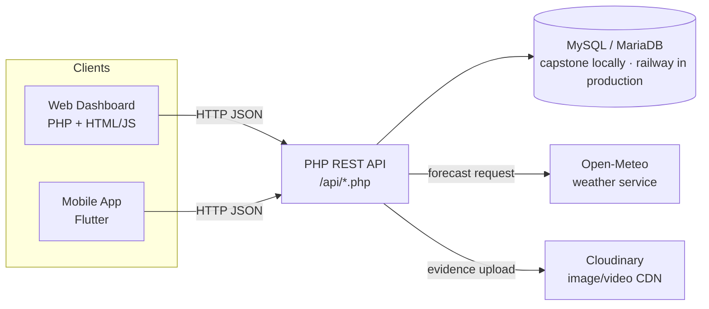

# OBILAK — System Overview

> **Barangay Disaster Reporting & Response System.** A reporting and coordination
> system that connects **barangays** with the **Municipal / Provincial
> coordination offices (PCF)** and the **Provincial Health Office (PHO)** during
> disasters in **Kalibo and Ibajay, Aklan**. Barangays report incidents from a
> mobile app; the municipal and provincial side monitors, verifies, and responds
> from a web dashboard — with maps, evacuation centers, hotlines, broadcast
> alerts, analytics, a needs-and-assistance board, and live weather.
>
> This document is both the **project README** and a plain-language **system
> overview**: what the system does, who uses it, how it's built, and how to run it.

---

## 1. What OBILAK is

During a typhoon or flood, the people on the ground (the barangays) and the
people coordinating the response (PCF / PHO) often can't see the same picture at
the same time. OBILAK closes that gap:

- **Barangays** submit incident reports (with photos/videos and a map pin) from
  their phones.
- **Coordinators (PCF / PHO)** see every report come in, verify it, update its
  status, and forward serious ones up the chain.
- **Everyone** shares one live view: a map of incidents and evacuation centers,
  an emergency hotline directory, broadcast alerts, a needs-and-assistance
  board, and a dashboard that turns the raw reports into simple charts.

Think of it as a **shared situation board** for the two municipalities, updated
straight from the field.

### The system in a nutshell

OBILAK is built like a **restaurant**:

- The **database** is the *pantry and storeroom* — it holds and remembers
  everything (reports, accounts, alerts, records).
- The **backend** (a set of PHP files called the *API*) is the *kitchen* — it
  takes orders, gets the right items from the storeroom, prepares the answer,
  and sends it back.
- The **clients** (the website and the mobile app) are the *customers at the
  table* — they place orders and receive plates. They never reach into the
  storeroom themselves; they always go through the kitchen.

Because both the website and the mobile app order from the **same kitchen**,
everyone is always served from the **same, single source of information**. That
is the most important idea in the whole system: **one shared brain, one shared
memory.**

---

## 2. Key Features

- 📝 **Incident reporting** — disaster type, description, people affected /
  injured / dead / missing, road and evacuation conditions, map location, and
  photo/video evidence.
- 🗺️ **Live map** — barangay halls, evacuation centers, and incident pins.
- 🏠 **Evacuation centers** — directory with capacity, current evacuees, and
  status (Available / Open / Full / Closed / Needs Supplies).
- 🧰 **Needs & Assistance** — evacuation centers post their needs; donors pledge
  assistance; barangays confirm receipt. Scoped by municipality.
- ☎️ **Emergency hotlines** — municipal and barangay-level contact directory.
- 📢 **Alerts / broadcasts** — send advisories to all or selected barangays,
  with severity levels and read tracking.
- 📊 **Dashboard analytics** — status breakdown, daily trend, human-impact
  tally, and a disaster-type bar chart, all filterable by month/year.
- 🌤️ **Weather card** — current conditions, a multi-day look-ahead, and a
  heavy-rain / strong-wind heads-up (powered by Open-Meteo).
- 👥 **Role- and sub-role-based access** — different powers for superadmin,
  barangay (captain / secretary / tanod), PCF (MDR / mayor), and PHO (admin /
  PDRRMO / governor) accounts.
- 🔎 **User-management audit trail** — administrative actions are logged.

---

## 3. How a request works (the core flow)

Everything in OBILAK follows the same simple back-and-forth. Here's what happens
every time a client needs something:

1. A client sends a **request** to one backend file (for example `login.php`),
   usually carrying some details (like a username and password).
2. The backend file uses a shared helper (`api_helper.php`) to read those
   details, open the database connection, and run the needed query.
3. The backend always replies in the **same standard "envelope"**:

   ```json
   {
     "success": true,
     "message": "Login successful.",
     "data": { "id": 5, "name": "Andagaw Barangay", "role": "barangay" }
   }
   ```

   - **success** — did it work? (true / false)
   - **message** — a short human-readable note.
   - **data** — the actual information requested (or an empty box on failure).

**Two things worth knowing about the core:**

- **Who's asking is sent in the request itself.** The system identifies the user
  by values passed in each request (like `user_id`, `role`, or `acting_user_id`)
  rather than a login token. It's simple and works well on a local network;
  stronger token-based login is noted as a future improvement (see §13).
- **The kitchen is open to its own clients.** The backend allows requests from
  the app and website (open CORS). This is fine for the local/classroom setup
  it's built for.

---

## 4. User Roles & Sub-roles

Every account has a **role** and most also have a **sub-role** that narrows what
it can see and do. Municipality-scoped roles only ever see their own
municipality (Kalibo or Ibajay).

| Role | Sub-role(s) | Who they are | What they mainly do |
|------|-------------|--------------|---------------------|
| **superadmin** | *(none)* | System administrator | Manage all user accounts, view the audit trail, full access everywhere |
| **barangay** | `captain` | Barangay captain | Submit & edit incident reports, set early statuses (Reviewed / Forwarded to PCF / Dismissed), manage the barangay account |
| **barangay** | `secretary` | Barangay secretary | Manage lower accounts (tanod), assist reporting |
| **barangay** | `tanod` | Barangay tanod | Submit incident reports |
| **pcf** | `mdr_admin` | MDR / coordination admin | Monitor & coordinate reports across both municipalities |
| **pcf** | `mdr_kalibo`, `mdr_ibajay` | Municipal MDR officer | Monitor & coordinate within their own municipality only |
| **pcf** | `mayor_kalibo`, `mayor_ibajay` | Municipal mayor | **Read-only** municipal view (reports, evidence, assistance) |
| **pho** | *(empty / admin)* | Provincial Health Office admin | Handle reports referred to PHO, update their status, pledge assistance |
| **pho** | `pdrrmo` | Provincial DRRM officer | Provincial DRRM monitoring and response |
| **pho** | `governor` | Provincial governor | **Read-only**, province-wide view |

Additional flags: `can_manage_users` allows an account to manage users below
its level, and `user_activity_logs` records user-management actions.

---

## 5. Tech Stack

| Layer | Technology |
|-------|------------|
| **Backend / API** | PHP 8 (procedural style, using `mysqli`), served by Apache |
| **Database** | MySQL / MariaDB (`utf8mb4`) |
| **Local server** | XAMPP (Apache + MySQL/MariaDB + PHP) |
| **Web dashboard** | PHP + HTML/CSS/vanilla JavaScript (no front-end framework; charts are hand-built) |
| **Mobile app** | Flutter (Dart) |
| **Maps** | Leaflet (web) / flutter_map (app), OpenStreetMap tiles |
| **Weather** | Open-Meteo public API (no key required) |
| **Evidence storage** | Cloudinary (production) with a local-disk fallback |
| **Config** | `.env` file locally / service variables in production |
| **Production host** | Railway (project `stunning-surprise`) |

**The guiding principle:** keep it **simple, free, and self-contained** — no paid
services and no internet-only libraries, so the whole thing can run on a single
local machine.

---

## 6. System Architecture



Both the web dashboard and the mobile app talk to the **same PHP API**, which is
the single doorway to the database (and, in production, to Cloudinary for
evidence).

---

## 7. Project Structure

```
sastergpt/                       # project root (XAMPP htdocs)
├─ api/                          # REST API: 40 endpoints + shared helpers
│  ├─ api_helper.php             # shared helpers (JSON envelope, DB, validation)
│  └─ user_audit.php             # audit-log helper
├─ app/                          # web dashboard server-side logic & includes
│  ├─ includes/                  # check_session, db header, sidebar, weather helper
│  └─ alerts/  auth/  evacuation-centers/  hotlines/  reports/  users/
├─ config/
│  ├─ db_connection.php          # engine DB connection (reads DB_* env vars)
│  ├─ env.php                    # small .env loader
│  ├─ app_config.php             # upload limits, DEBUG_MODE
│  └─ cloudinary.php             # evidence uploads (CLOUDINARY_URL), local fallback
├─ public/                       # web dashboard pages + entry points (dashboard.php, login, …)
│  ├─ asset/                     # CSS, JS, images
│  └─ uploads/                   # local-disk fallback for uploaded evidence
├─ database/
│  ├─ capstone.sql               # local schema + seed data (import this locally)
│  ├─ Railway/                   # production dump (import into the railway DB)
│  ├─ backups/  migrations/
├─ flutter/
│  └─ flutter_saster/            # Flutter mobile app
│     └─ lib/
│        ├─ constants/           # api_config.dart, app_colors.dart
│        ├─ models/              # Data models
│        ├─ screens/             # App screens (by role)
│        ├─ services/            # API clients (one per feature)
│        ├─ utils/  widgets/     # Helpers & reusable widgets
│        └─ main.dart            # App entry point
├─ uploads/                      # legacy local evidence directory
├─ .env / .env.example           # environment configuration
└─ obilak-docs/                  # API.md, DATABASE.md, README.md, CHANGELOG.md
```

---

## 8. Key Files

**Backend & database (the core):**

| File | What it does |
|------|--------------|
| `api/api_helper.php` | The shared toolbox **every** endpoint uses — reads the request, opens the database, and sends back the standard `{success, message, data}` envelope. |
| `api/user_audit.php` | Records user-management actions and resolves read-only roles. |
| `config/db_connection.php` | The **single place** the database connection is set up (reads `DB_HOST`, `DB_USER`, `DB_PASS`, `DB_NAME`, `DB_PORT`). Change the env, and the whole backend follows. |
| `config/cloudinary.php` | Uploads incident evidence to Cloudinary when `CLOUDINARY_URL` is set; otherwise falls back to local disk. |
| `database/capstone.sql` | The **local database blueprint + seed data** — creates all 16 tables and the default accounts. |
| `app/includes/weather_helper.php` | Fetches weather from Open-Meteo and caches it (30 min) so the system isn't constantly re-asking. |
| `api/login.php`, `create_incident.php`, `get_reports.php`, `get_dashboard_summary.php`, … | Each handles **one job.** Their names tell you what they do. *(See [API.md](API.md) for every endpoint.)* |

**Mobile app:**

| File / folder | What it does |
|---------------|--------------|
| `flutter/flutter_saster/lib/constants/api_config.dart` | Where the app is told **the backend's address** (build-time `API_BASE_URL`). |
| `flutter/flutter_saster/lib/services/api_service.dart` | The base "messenger" all other services build on — sends requests and reads the standard envelope. |
| `flutter/flutter_saster/lib/services/*_service.dart` | One messenger per feature (incidents, alerts, users, dashboard…). |
| `flutter/flutter_saster/lib/models/*_model.dart` | Define the **shape** of each kind of data. |
| `flutter/flutter_saster/lib/widgets/dashboard_summary_view.dart` | The shared dashboard view (charts + weather) used across roles. |

---

## 9. Setup & Installation

### A. Backend (web + API + database)

1. **Install XAMPP** (Apache + MySQL/MariaDB + PHP 8).
2. **Copy the project folder** into your XAMPP `htdocs` directory.
3. **Start Apache and MySQL** from the XAMPP control panel.
4. **Create the database**:
   - Open phpMyAdmin (`http://localhost/phpmyadmin`).
   - Create a database named **`capstone`**.
   - Import **`database/capstone.sql`** (builds all 16 tables and loads the seed
     data — barangays, disaster types, hotlines, evacuation centers, and default
     accounts).
5. **Configure the connection** — copy **`.env.example`** to **`.env`** and set:
   ```
   DB_HOST=localhost
   DB_USER=root
   DB_PASS=
   DB_NAME=capstone
   DB_PORT=3306
   ```
   (Optionally set `CLOUDINARY_URL` to host evidence on Cloudinary instead of
   local disk.)
6. Open the dashboard at **`http://localhost/<your-folder>/public/`**.

> **Deployment (Railway):** set the same keys as service variables. On the live
> deployment `DB_NAME=railway` (the app reads that database, not `capstone`), and
> `CLOUDINARY_URL` is set so evidence survives redeploys. See
> [DATABASE.md](DATABASE.md) for the local-vs-Railway differences.

### B. Mobile app (Flutter)

1. Install Flutter (Dart SDK `^3.12.0`).
2. Point the app at your backend **at build time** (no file edit needed):
   ```
   flutter run --dart-define=API_BASE_URL=http://<your-server-ip>/<your-folder>
   ```
   Use your computer's LAN IP (not `localhost`) so the phone can reach it. With
   no `--dart-define`, the app defaults to the current Railway deployment.
3. `flutter pub get`, then `flutter run` (or build an APK).

> **Weather note:** the **server** needs internet access to fetch forecasts; it
> caches each result for 30 minutes. Offline, the weather card shows the last
> saved reading or hides itself.

---

## 10. Default Accounts

The seed data creates the starter logins below. **All seeded accounts use the
password `admin123`.**

| Username | Role | Sub-role |
|----------|------|----------|
| `superadmin` | superadmin | — |
| `pcfadmin` | pcf | mdr_admin |
| `phoadmin` | pho | — |

Barangay, MDR, mayor, PDRRMO, and governor accounts are provisioned from the
**Manage Users** screen (or the seed), and also default to `admin123`.

> ⚠️ **Change every password before any real deployment.**

---

## 11. Database

The database has **16 tables**. The core ones are `users`, `barangays`,
`incident_reports`, `incident_attachments`, `incident_status_logs`,
`evacuation_centers`, `emergency_hotlines`, `alerts`, and their supporting
tables.

- **Accounts & places** — `users`, `barangays` (51 total: 16 Kalibo + 35
  Ibajay), `disaster_types`.
- **Incidents** — `incident_reports`, `incident_attachments`,
  `incident_status_logs`.
- **Resources** — `evacuation_centers`, `emergency_hotlines`, plus the needs /
  assistance tables `evac_center_profile`, `evac_center_needs`,
  `evac_assistance`.
- **Alerts** — `alerts`, `alert_barangays`, `alert_reads`.
- **Provincial facilities & tracking** — `pcf_facilities`,
  `user_activity_logs`.

See **[DATABASE.md](DATABASE.md)** for the full schema, column-by-column notes,
the entity-relationship diagram, and the local-vs-Railway differences.

---

## 12. API

The app and dashboard communicate through a JSON REST API under `api/`. Every
response uses the same shape:

```json
{ "success": true, "message": "...", "data": { } }
```

See **[API.md](API.md)** for every endpoint, its inputs, and example
requests/responses.

---

## 13. Known Limitations

- **No token-based auth yet** — the API identifies the caller through values
  passed in the request body (e.g. `user_id`, `role`, `acting_user_id`) rather
  than a session token. Intended for the local/development setup; add proper
  authentication before any public deployment.
- **CORS is fully open** (`Access-Control-Allow-Origin: *`) for development.
- A small number of management endpoints are **reserved for a later phase**
  (see [API.md](API.md)).
- The weather card is a **guide, not an official PAGASA signal**.

---

## 14. Authors / Credits

- Capstone project — *(add team member names here)*
- Weather data: [Open-Meteo](https://open-meteo.com) (free, no API key)
- Maps: OpenStreetMap via Leaflet / flutter_map
- Evidence hosting: [Cloudinary](https://cloudinary.com)
